# Werkplaats 2 - Accessibility Hub

Een webapplicatie voor **Stichting Accessibility** die ervaringsdeskundigen verbindt met organisaties voor toegankelijkheidsonderzoek.

## 📋 Inhoudsopgave
- [Installatie Instructies](#installatie-instructies)
- [Opstart Instructies](#opstart-instructies)
- [Inloggegevens](#inloggegevens)
- [Screenshots](#screenshots)
- [Functionaliteiten](#functionaliteiten)
- [APA Bronnen](#apa-bronnen)

---

## 🔧 Installatie Instructies

### Vereisten
- Python 3.8 of hoger
- pip (Python package installer)
- Git

### Stap 1: Repository Klonen
```bash
git clone https://github.com/Rac-Software-Development/rac-software-development-2025-2026-wp2-2025-mvc-wp2_2025_starter.git
cd rac-software-development-2025-2026-wp2-2025-mvc-wp2_2025_starter
```

### Stap 2: Virtual Environment Aanmaken
**Windows:**
```bash
python -m venv .venv
.venv\Scripts\activate
```

**macOS/Linux:**
```bash
python3 -m venv .venv
source .venv/bin/activate
```

### Stap 3: Dependencies Installeren
```bash
pip install -r requirements.txt
```

### Stap 4: Database Initialiseren (optioneel)
De database `data/app.db` bestaat al met demo-data. Als je de database opnieuw wilt aanmaken:
```bash
python data/seed.py
```

---

## 🚀 Opstart Instructies

### Applicatie Starten

**Windows:**
```bash
.venv\Scripts\activate
python app.py
```

**macOS/Linux:**
```bash
source .venv/bin/activate
python app.py
```

De applicatie start op: **http://127.0.0.1:5000** of **http://localhost:5000**

### Applicatie Stoppen
Druk op `Ctrl+C` in de terminal om de server te stoppen.

---

## 🔐 Inloggegevens

### Beheerder (Admin)
- **Email:** `admin@hub.com`
- **Wachtwoord:** `admin`
- **Rol:** Administrator
- **Toegang tot:** Dashboard, gebruikersbeheer, goedkeuringen

---

### Organisaties

| Email | Wachtwoord | Organisatie | Status |
|-------|-----------|-------------|--------|
| `org-ah@hub.com` | `secret` | Albert Heijn | Nieuw |
| `org-microsoft@seed.nl` | `secret` | Microsoft | Nieuw |
| `org-facebook@seed.nl` | `secret` | Facebook | Nieuw |
| `org-apple@seed.nl` | `secret` | Apple | Nieuw |

**Rol:** Organisatie  
**Status:** Nieuw (moet eerst goedgekeurd worden door admin)  
**Toegang tot:** Onderzoeken aanmaken en beheren

---

### Ervaringsdeskundigen

| Email | Wachtwoord | Naam | Status |
|-------|-----------|------|--------|
| `sanne@example.com` | `secret` | Sanne | Goedgekeurd |
| `jamal@example.com` | `secret` | Jamal | Goedgekeurd |
| `lotte@example.com` | `secret` | Lotte | Goedgekeurd |
| `expert1@seed.nl` | `secret` | Expert 1 | Goedgekeurd |
| `expert2@seed.nl` | `secret` | Expert 2 | Goedgekeurd |
| `expert3@seed.nl` | `secret` | Expert 3 | Goedgekeurd |
| `expert4@seed.nl` | `secret` | Expert 4 | Goedgekeurd |
| `expert5@seed.nl` | `secret` | Expert 5 | Goedgekeurd |

**Rol:** Ervaringsdeskundige  
**Toegang tot:** Onderzoeken zoeken, inschrijven, profiel beheren

---

## 📸 Screenshots

### Accessibility Hub Logo
De applicatie beschikt over een professioneel ontworpen logo dat de kernwaarden van toegankelijkheid en inclusiviteit uitstraalt.

### Responsive Design
De volledige applicatie is responsive ontworpen en werkt naadloos op alle schermformaten:
- 🖥️ **Desktop** (1920px+) - Volledig dashboard met alle features
- 💻 **Laptop** (1024px-1919px) - Geoptimaliseerde layout
- 📱 **Tablet** (768px-1023px) - Touch-friendly interface
- 📱 **Mobiel** (320px-767px) - Mobile-first responsive design

### Dashboard
Het dashboard is het eerste wat je ziet als je naar onze website gaat en biedt een overzicht om in te loggen, regristreren, homepagina en infomatie pagina


*Info pagina*
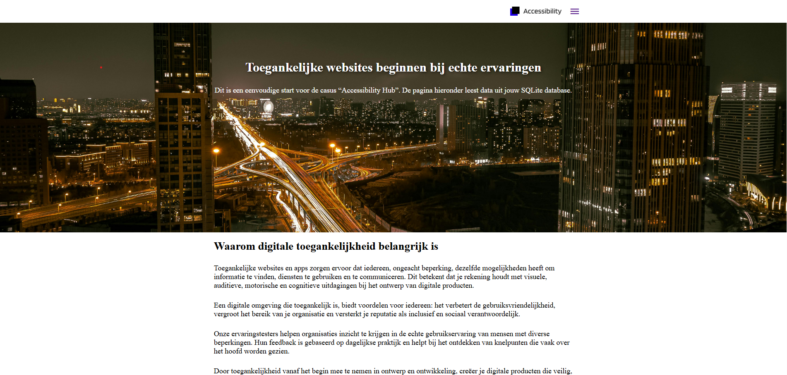

*Login pagina om in te loggen*
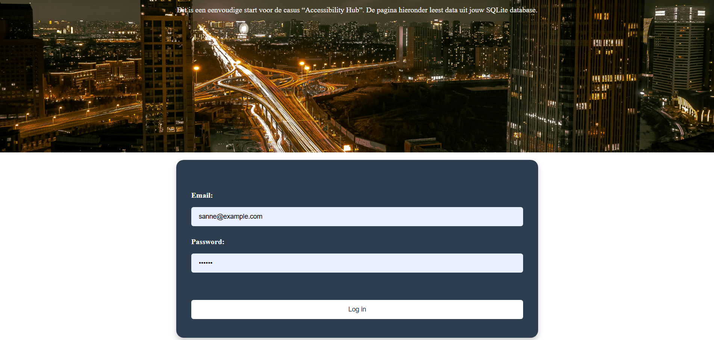

*Registreer pagina om te registreren*
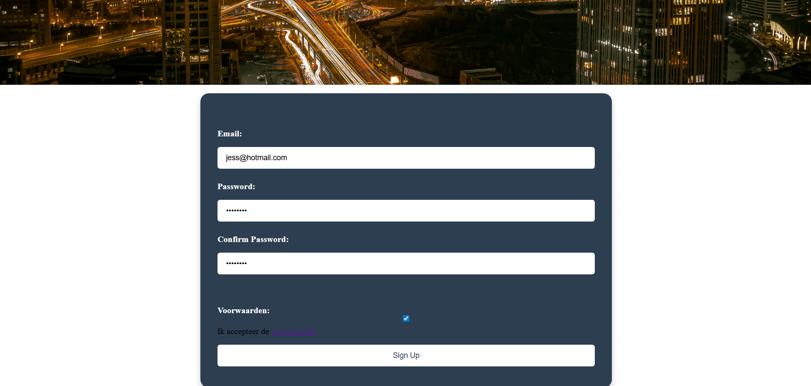

*Profiel pagina om je profiel aan te maken*
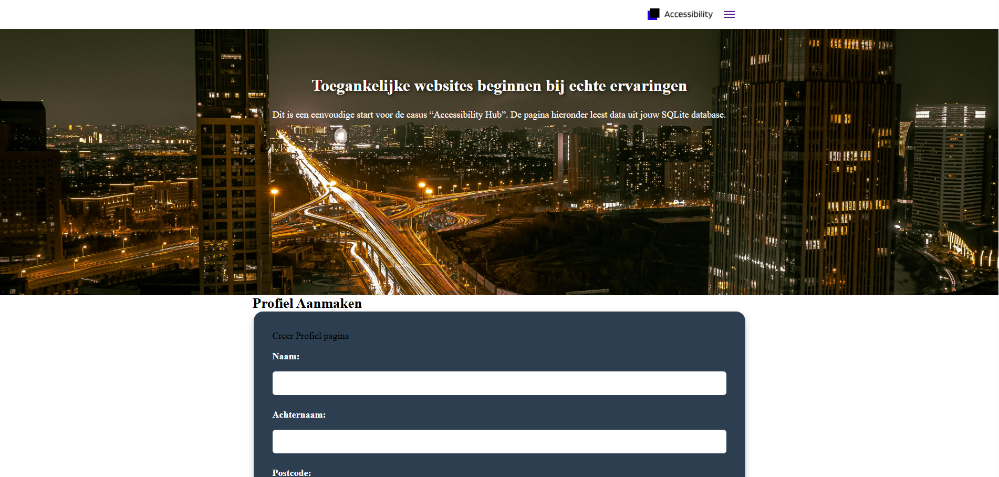

*Emails binnen krijgen nadat een admin een actie uitvoert (Gebruikt Mailpit)*
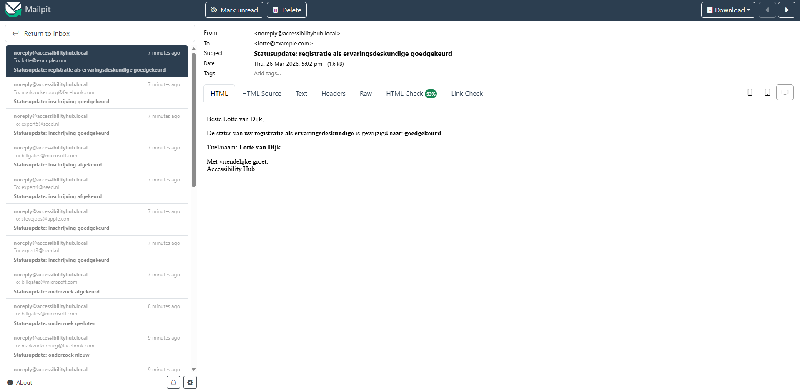

*Onderzoeken en Inschrijvingen kunnen exporteren naar CSV bestanden*
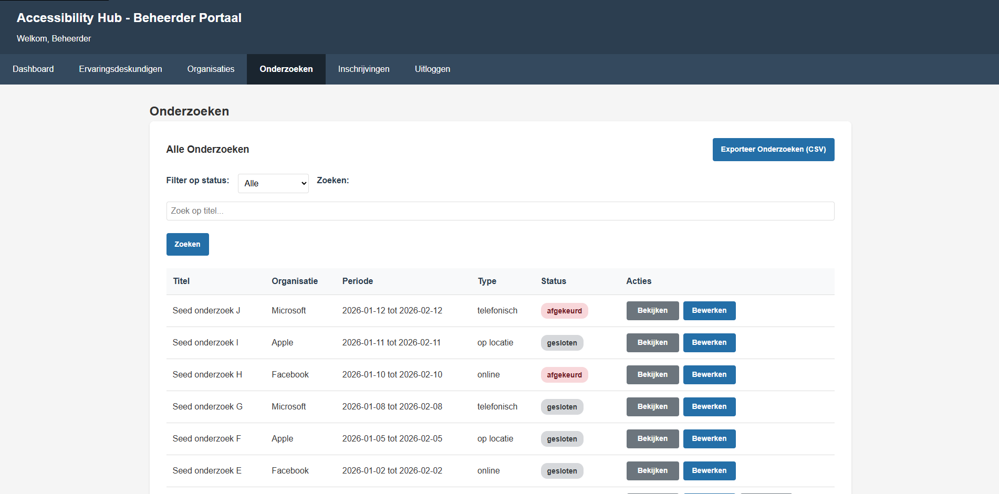
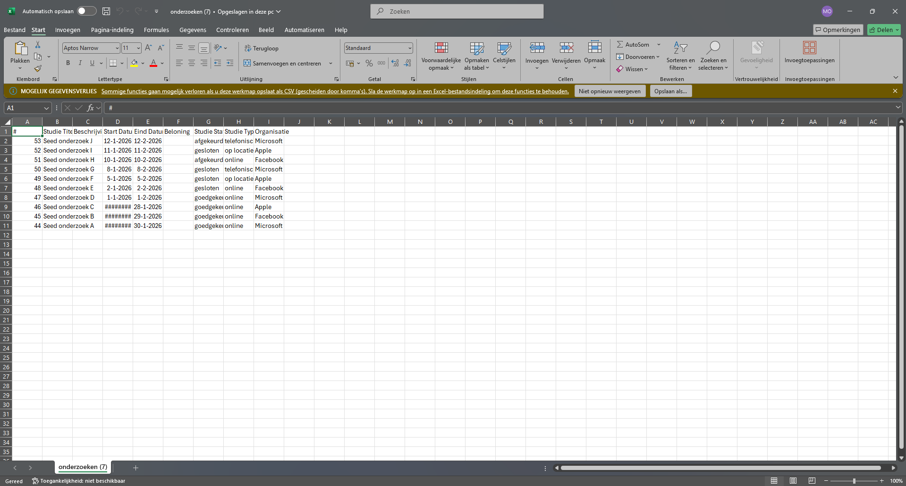
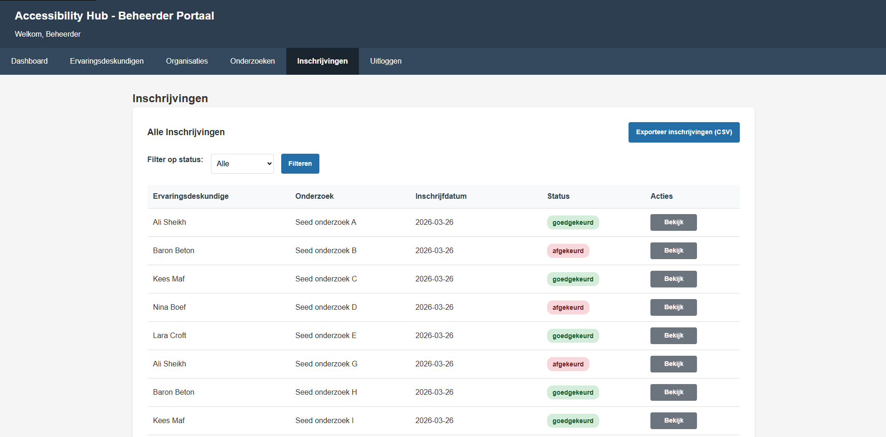
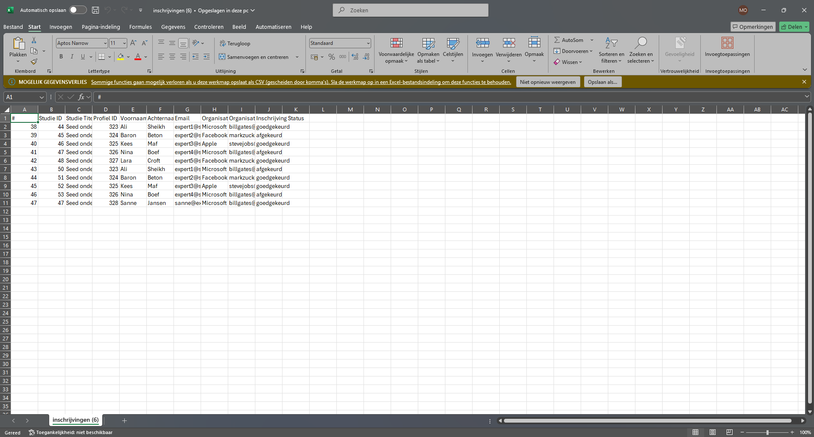

*Organisaties kunnen onderzoeken exporteren naar ICS bestanden*
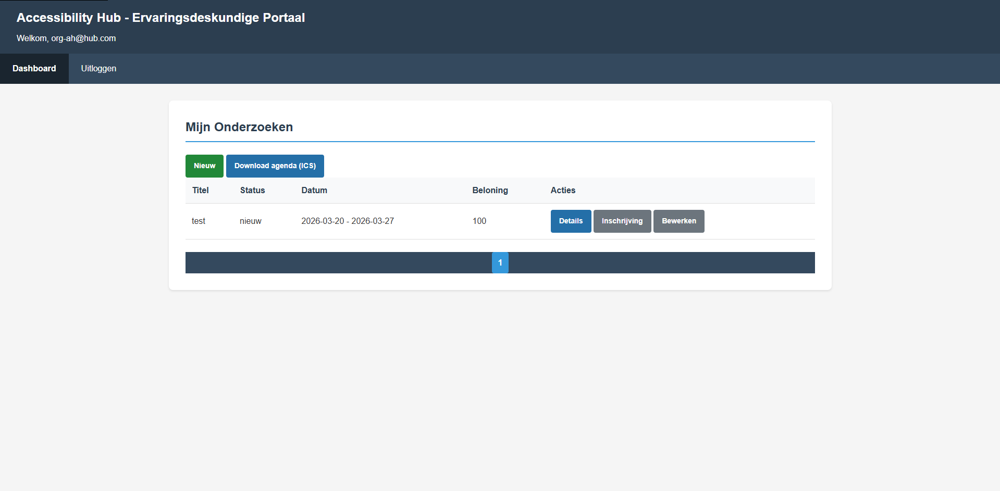
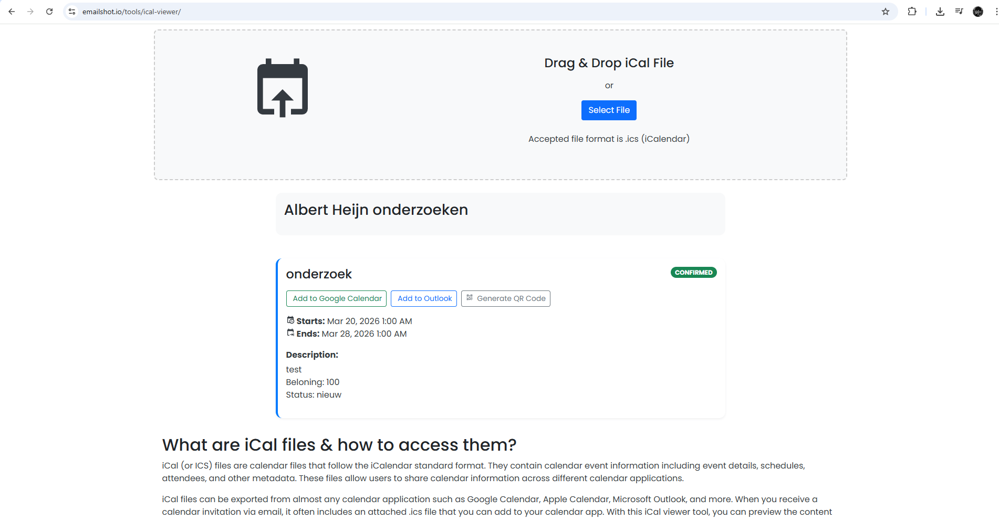

### Admin Dashboard
Het dashboard biedt een overzicht van alle nieuwe registraties, onderzoeken in beoordeling, nieuwe inschrijvingen en totaal aantal organisaties. Beheerders kunnen direct acties uitvoeren zoals goedkeuren of afkeuren.

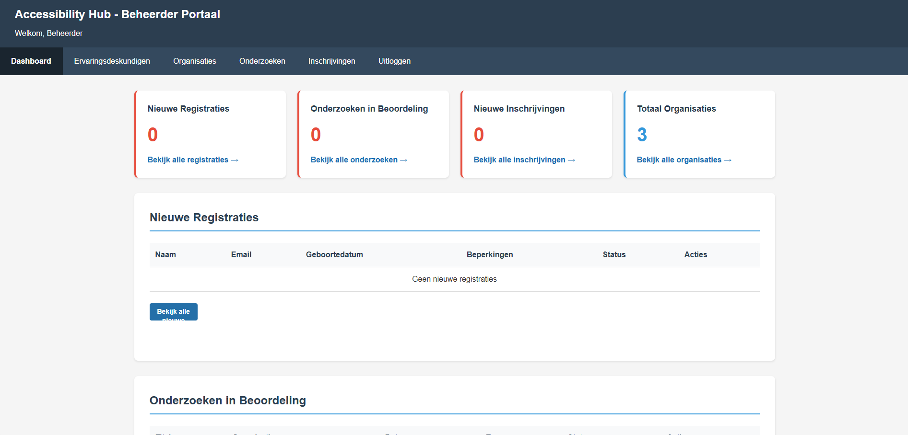
*Admin Dashboard met statistieken en nieuwe registraties*

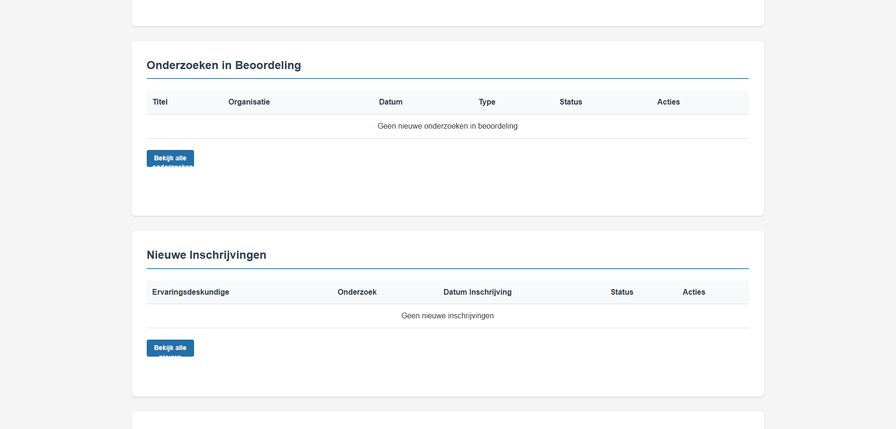
*Onderzoeken in beoordeling sectie*

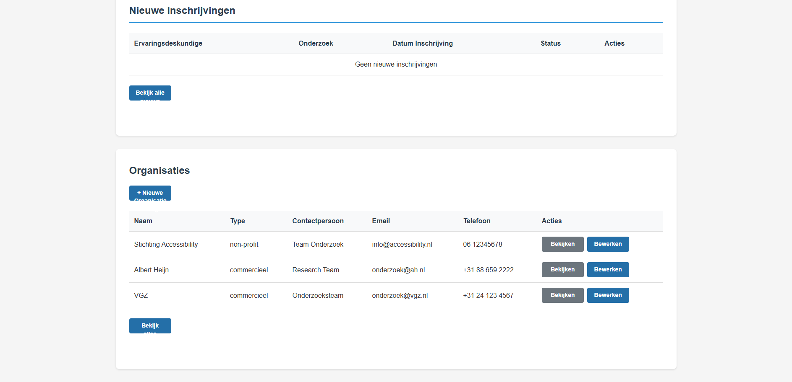
*Organisaties sectie met beheeropties*

### Ervaringsdeskundigen Beheer
Beheerders kunnen ervaringsdeskundigen bekijken, bewerken en hun status aanpassen. De lijst ondersteunt zoeken en filteren op status.

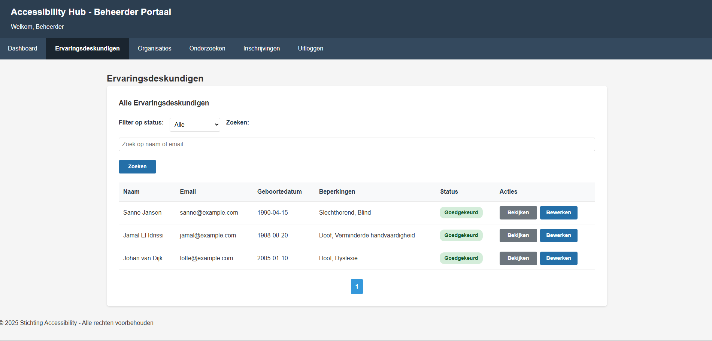
*Overzicht van alle ervaringsdeskundigen met filters en paginatie*

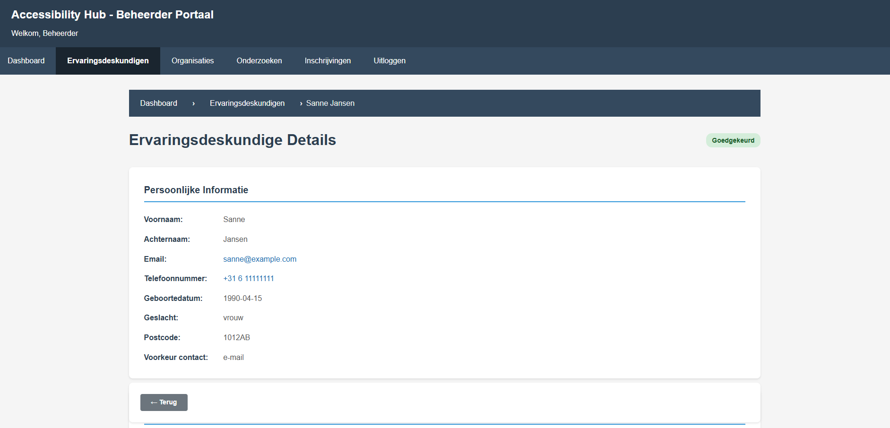
*Gedetailleerde informatie van een ervaringsdeskundige*

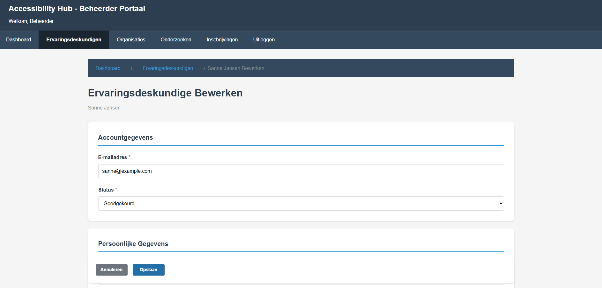
*Bewerkformulier voor ervaringsdeskundige gegevens*

### Organisaties Beheer
Nieuwe organisaties kunnen worden toegevoegd en bestaande organisaties kunnen worden gekoppeld aan gebruikers. Het systeem ondersteunt zowel commerciële als non-profit organisaties.

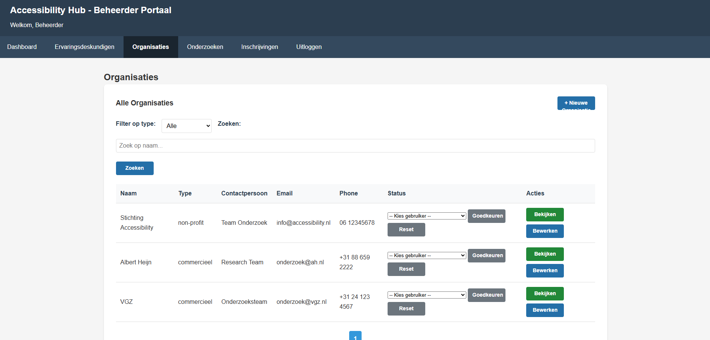
*Overzicht van organisaties met user assignment en filters*

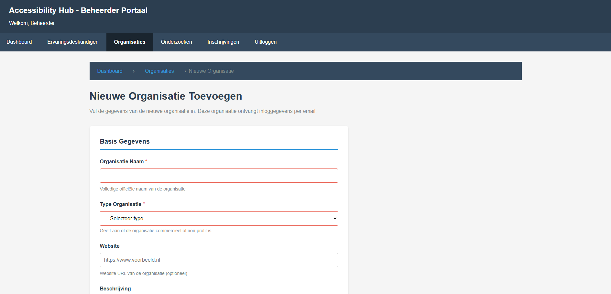
*Formulier voor het toevoegen van een nieuwe organisatie*

### Onderzoeken Beheer
Onderzoeken kunnen worden goedgekeurd, afgekeurd of gesloten. De lijst toont alle belangrijke informatie en ondersteunt filteren op status.

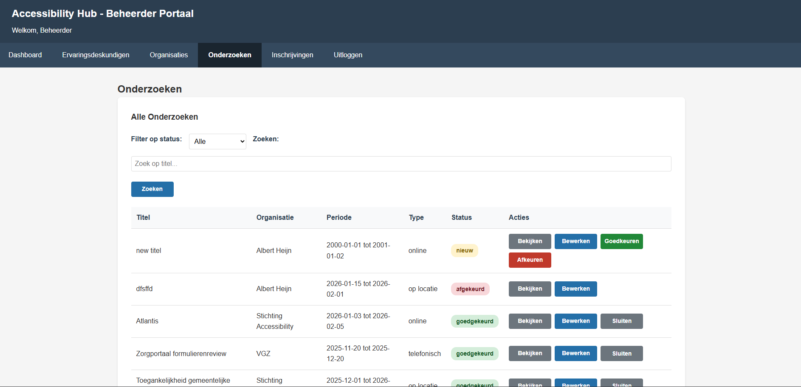
*Overzicht van alle onderzoeken met status en acties*

### Inschrijvingen Beheer
Beheerders kunnen inschrijvingen van ervaringsdeskundigen voor onderzoeken goedkeuren of afkeuren. De lijst toont datum, onderzoek en status.

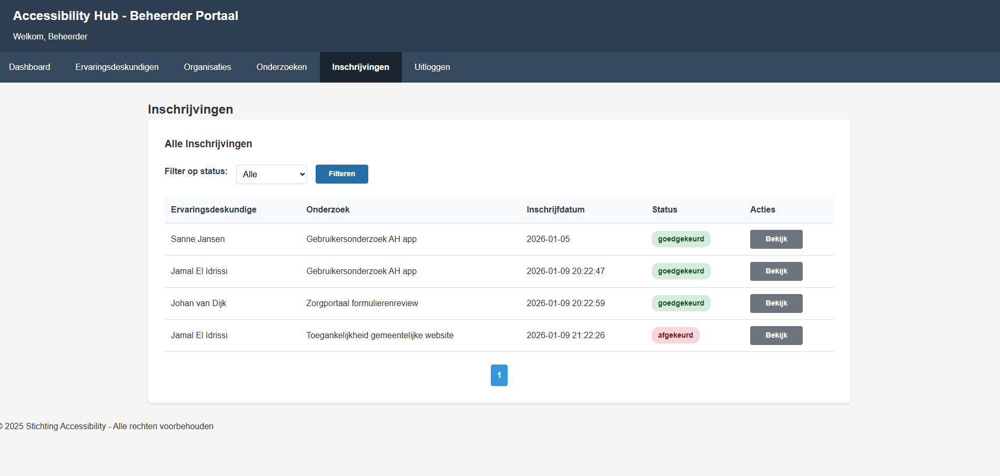
*Overzicht van alle inschrijvingen met filter op status*

## Organization dashboard 
Het organisatie dashboard stelt organisaties in staat om hun onderzoeken te beheren.


### Overzicht onderzoeken

Op deze pagina ziet de organisatie een overzicht van alle aangemaakte onderzoeken. Per onderzoek zijn de status, periode en beloning zichtbaar. Vanuit hier kan een onderzoek worden bekeken, bewerkt of kunnen inschrijvingen worden ingezien.

### Onderzoek bewerken

Deze pagina stelt organisaties in staat om bestaande onderzoeken aan te passen. Gegevens zoals titel, datums, beloning en beschrijving kunnen hier worden gewijzigd.


### Goedgekeurde inschrijvingen

Organisatie ziet wie is goedgekeurd voor een specifiek onderzoek. Dit biedt inzicht in wie daadwerkelijk deelnemen.

### Details onderzoek

Toont alle details van een onderzoek.

### Nieuw onderzoek aanmaken

Organisatie kan een nieuw onderzoek aanmaken

---

## Functionaliteiten

### Algemeen
- MVC-architectuur met Flask, Jinja2, SQLite
- Server-side rendering
- POST/Redirect/GET patroon voor formulieren
- WCAG 2.1 AA compliant (toegankelijkheid)
- **Volledig responsive design** - Werkt op desktop, tablet en mobiel
- **Custom logo** - Professioneel ontworpen logo voor Stichting Accessibility
- Moderne gebruikersinterface met intuïtieve navigatie

### Beheerder Portal
- Dashboard met overzicht nieuwe registraties, onderzoeken en inschrijvingen
- Goedkeuren/Afkeuren van experts, onderzoeken en inschrijvingen
- Organisaties aanmaken en beheren
- Zoeken en filteren met paginatie
- Template inheritance met `admin_base.html.jinja`

### Ervaringsdeskundige Portal
- Registratie met meerstaps-formulier
- Dashboard met passende onderzoeken (gefilterd op profiel)
- **Intelligente filtering** - Onderzoeken worden automatisch gefilterd op basis van de beperking (disability) van de ervaringsdeskundige
- **Dynamisch filter** - Bij wijziging van beperking in profiel worden direct relevante onderzoeken getoond
- Inschrijven voor onderzoeken
- Profiel beheren
- Overzicht eigen inschrijvingen per status

### Organisatie Portal
- Onderzoeken aanmaken en bewerken
- Overzicht inschrijvingen per onderzoek
- Dashboard met eigen onderzoeken

### Toegankelijkheid (WCAG 2.1 AA)
- Skip links voor toetsenbordnavigatie
- Semantische HTML (header, nav, main, footer)
- ARIA labels en landmarks
- Form labels gekoppeld aan inputs
- Focus states voor toetsenbordgebruikers
- Screen reader ondersteuning (VoiceOver, NVDA, JAWS)
- Visueel verborgen content voor context

### Bonus Functionaliteiten
- *Nog toe te voegen: CSV export*
- *Nog toe te voegen: ICS agenda bestanden*
- *Nog toe te voegen: Email notificaties*

---
## Overzicht Gebruikte Technieken

Dit document bevat een overzicht van alle technieken, frameworks en standaarden die zijn gebruikt in de ontwikkeling van de Accessibility
Hub Admin Portal applicatie.

---

## 1. Backend Framework (Flask)

### Gebruikte Flask technieken:
- Route decorators (`@app.route()`)
- Path converters (`<int:id>`, `<string:name>`)
- HTTP method handling (`methods=["GET", "POST"]`)
- Request handling (`request.args`, `request.form`, `request.method`)
- Response functies (`render_template()`, `redirect()`, `url_for()`)
- Flash messages (`flash()`)
- Session management (`session`, `session.get()`, `session.pop()`)
- Application globals (`g`, `app.secret_key`)
- Request hooks (`@app.before_request`)

**Bronverwijzing:** Pallets Projects. (z.d.). *Flask documentation*. https://flask.palletsprojects.com/

---

## 2. Template Engine (Jinja2)

### Gebruikte Jinja2 technieken:
- Template inheritance (``, ``)
- Variabele output (`{{ variable }}`)
- Control structures (``, ``, ``, ``)
- URL generatie (`{{ url_for() }}`)
- Template filters (`|capitalize`, ternary expressies)

**Bronverwijzing:** Pallets Projects. (z.d.). *Jinja documentation*. https://jinja.palletsprojects.com/

---

## 3. Database (SQLite)

### Gebruikte SQL technieken:
- Database connectie (`sqlite3.connect()`, `cursor()`, `commit()`, `close()`)
- Result verwerking (`fetchone()`, `fetchall()`)
- Row factory (`sqlite3.Row`) voor dictionary-style column access (row['column_name'] en row[index])
- CRUD operaties (SELECT, INSERT, UPDATE, DELETE)
- Parameterized queries (SQL injection preventie)
- Paginatie (LIMIT, OFFSET, ORDER BY)
- JOIN operaties (INNER JOIN, LEFT JOIN, Multiple JOINs)
- Table aliases
- Bulk operaties (`executemany()`)
- Database constraints (`PRAGMA foreign_keys = ON`)
- Subqueries in INSERT statements

**Bronverwijzing:** SQLite Consortium. (z.d.). *SQLite documentation*. https://www.sqlite.org/docs.html

---

## 4. Python Programmeerconcepten

### Gebruikte Python technieken:
- String methods (`.strip()`, `.lower()`, `.upper()`, `.replace()`, `.startswith()`)
- F-strings voor string formatting
- Type conversies (`int()`, `str()`, `bool()`)
- Datastructuren (lists, tuples, dictionaries)
- Dictionary comprehensions voor ID mapping
- List comprehensions met filtering
- `.get()` method voor safe dictionary access
- Control flow (`if/elif/else`, `for`, `while`)
- Ternary operator (`value if condition else default`)
- Walrus operator (`:=`)
- Error handling (`try/except`, specifieke exceptions: `ValueError`, `sqlite3.Error`)
- Object-georiënteerd programmeren (classes, `__init__`, instance methods, instance variables)
- Context managers (`with` statements voor resource management)
- Datetime operaties (`datetime.strptime()`, `datetime.now()`, datum vergelijkingen)
- Regular expressions (`re.match()`, `re.search()`, raw strings `r'...'`, character classes, quantifiers)
- Type checking (`isinstance()`)
- Script entry point (`if __name__ == '__main__'`)
- OS module (`os.path.dirname()`, `os.path.join()`) voor platform-onafhankelijke paths
- Defensive programming (None checks, data validatie voor edge cases)

**Bronverwijzing:** Python Software Foundation. (z.d.). *Python documentation*. https://docs.python.org/3/

---

## 5. Validatie Module (utils/validators.py)

### Gebruikte validatie technieken:
- Email validatie (regex pattern met character classes: `[a-zA-Z0-9._%+-]`)
- Postcode validatie (Nederlands formaat: 1234AB met pattern `[1-9][0-9]{3}\s?[A-Z]{2}`)
- Telefoonnummer validatie (Nederlands formaat: 06-12345678, +31-6-12345678)
- Character cleaning (`.replace()` voor spaties en streepjes)
- Prefix checking (`.startswith('+31')`)
- Datum validatie (geboortedatum, date range)
- Toekomstige datum detectie (`datetime.now()` vergelijking)
- Generic veld validatie met `isinstance()` type checking
- Form validators (expert_form, study_form, organization_form)
- Error dictionary returns voor foutafhandeling
- Custom validatie functies met None returns
- String trimming en empty string detectie

**Bronverwijzing:** Python Software Foundation. (z.d.). *re — Regular expression operations*. https://docs.python.org/3/library/re.html

---

## 6. Database Seeding (data/seed.py)

### Gebruikte seeding technieken:
- Test data generatie met lists van tuples
- DELETE statements voor data cleanup (CASCADE)
- Bulk inserts met `executemany()`
- List van tuples voor batch data
- Dictionary comprehensions voor ID mapping (`{row['name']: row['id'] for row in ...}`)
- Subqueries in INSERT statements (`INSERT ... SELECT ... FROM ... WHERE`)
- Transaction management (`commit()`, `close()`)
- PRAGMA foreign_keys = ON voor referential integrity
- Script entry point (`if __name__ == '__main__'`)

**Bronverwijzing:** Python Software Foundation. (z.d.). *sqlite3 — DB-API 2.0 interface for SQLite databases*. https://docs.python.org/3
library/sqlite3.html

---

## 7. Frontend (HTML5)

### Gebruikte HTML5 technieken:
- Semantische elementen (`<header>`, `<nav>`, `<main>`, `<section>`, `<footer>`, `<article>`)
- Formulieren (input types: `email`, `tel`, `text`, `date`, `password`, `number`)
- Form attributes (`required`, `method="POST"`, `method="GET"`, `action`, `name`, `id`)
- Labels voor accessibility (`<label for="...">`).
- Tabellen (`<table>`, `<thead>`, `<tbody>`, `<tr>`, `<th>`, `<td>`)
- Table accessibility (`scope="col"`, `scope="row"`)
- Buttons (`<button type="submit">`, `<button type="button">`)
- Links (`<a href="...">`)
- Lists (`<ul>`, `<ol>`, `<li>`)
- Form validation attributes

**Bronverwijzing:** W3Schools. (z.d.). *HTML tutorial*. https://www.w3schools.com/html/

---

## 8. Styling (CSS3)

### Gebruikte CSS3 technieken:
- Flexbox layout (`display: flex`, `justify-content`, `align-items`, `flex-direction`, `flex-wrap`)
- CSS Grid layout (`display: grid`, `grid-template-columns`, `gap`, `grid-template-areas`)
- Responsive units (`rem`, `em`, `%`, `vh`, `vw`, `px`)
- CSS custom properties (CSS variables: `--primary-color`, `:root`, `var()`)
- Box model (`padding`, `margin`, `border`, `box-sizing`)
- Positioning (`position: absolute`, `position: relative`, `position: fixed`)
- Pseudo-classes (`:hover`, `:focus`, `:active`, `:first-child`, `:last-child`)
- Pseudo-elements (`::before`, `::after`)
- Media queries voor responsive design
- Transitions en animations
- Accessibility helpers (`.visually-hidden`, focus styling met `outline`, skip links)
- Color contrast (WCAG 2.1 AA compliant: minimum 4.5:1)

**Bronverwijzing:** W3Schools. (z.d.). *CSS tutorial*. https://www.w3schools.com/css/

---

## 9. Accessibility (WCAG 2.1 AA)

### Gebruikte accessibility technieken:
- ARIA attributes (`aria-label`, `aria-current`, `role`)
- Semantic HTML5 elements
- Focus management (zichtbare focus indicators)
- Kleurcontrast (minimum 4.5:1 voor normale tekst)
- Keyboard navigatie
- Alt-teksten voor afbeeldingen
- Formulier labels (alle inputs hebben labels)
- Skip links
- Screen reader optimalisatie

**Bronverwijzing:** World Wide Web Consortium. (2018). *Web Content Accessibility Guidelines (WCAG) 2.1*. https://www.w3.org/TR/WCAG21/

---

## 10. Architectuur & Design Patterns

### Gebruikte design patterns:
- MVC-architectuur (Model-View-Controller)
- POST/Redirect/GET pattern
- Repository pattern

**Bronverwijzing:** Pallets Projects. (z.d.). *Flask documentation*. https://flask.palletsprojects.com/

---

## 11. Security

### Gebruikte security technieken:
- SQL injection preventie (parameterized queries)
- CSRF protection setup
- Session management (secure keys)
- Role-based access control
- Request hooks voor authenticatie

**Bronverwijzing:** Python Software Foundation. (z.d.). *sqlite3 — DB-API 2.0 interface for SQLite databases*. https://docs.python.org/3
library/sqlite3.html

---

## APA Bronnen

*Bronvermeldingen volgens APA-normen worden hier toegevoegd...*
## Yavuz Atilgan (1073705)

### Python (Officiële Documentatie)

Python Software Foundation. (z.d.). *Python documentation*. https://docs.python.org/3/

Python Software Foundation. (z.d.). *Built-in functions*. https://docs.python.org/3/library/functions.html

Python Software Foundation. (z.d.). *datetime — Basic date and time types*. https://docs.python.org/3/library/datetime.html

Python Software Foundation. (z.d.). *re — Regular expression operations*. https://docs.python.org/3/library/re.html

Python Software Foundation. (z.d.). *sqlite3 — DB-API 2.0 interface for SQLite databases*. https://docs.python.org/3/library/sqlite3.html

Python Software Foundation. (z.d.). *stdtypes — Built-in types*. https://docs.python.org/3/library/stdtypes.html
Python Software Foundation. (z.d.). *os.path — Common pathname manipulations*. https://docs.python.org/3/library/os.path.html


### Flask (Officiële Documentatie)

Pallets Projects. (z.d.). *Flask documentation*. https://flask.palletsprojects.com/

Pallets Projects. (z.d.). *Quickstart: Routing*. https://flask.palletsprojects.com/en/latest/quickstart/#routing

Pallets Projects. (z.d.). *API: Request (incoming request data)*. https://flask.palletsprojects.com/en/latest/api/#incoming-request-data

Pallets Projects. (z.d.). *Quickstart: Sessions*. https://flask.palletsprojects.com/en/latest/quickstart/#sessions

Pallets Projects. (z.d.). *Patterns: Flashing*. https://flask.palletsprojects.com/en/latest/patterns/flashing/

### Jinja2 (Officiële Documentatie)

Pallets Projects. (z.d.). *Jinja documentation*. https://jinja.palletsprojects.com/

Pallets Projects. (z.d.). *Template inheritance*. https://jinja.palletsprojects.com/en/latest/templates/#template-inheritance

Pallets Projects. (z.d.). *Control structures*. https://jinja.palletsprojects.com/en/latest/templates/#list-of-control-structures

Pallets Projects. (z.d.). *Filters*. https://jinja.palletsprojects.com/en/latest/templates/#filters

### HTML5 (W3Schools)

W3Schools. (z.d.). *HTML tutorial*. https://www.w3schools.com/html/

W3Schools. (z.d.). *HTML semantic elements*. https://www.w3schools.com/html/html5_semantic_elements.asp

W3Schools. (z.d.). *HTML forms*. https://www.w3schools.com/html/html_forms.asp

W3Schools. (z.d.). *HTML form elements*. https://www.w3schools.com/html/html_form_elements.asp

W3Schools. (z.d.). *HTML input types*. https://www.w3schools.com/html/html_form_input_types.asp

W3Schools. (z.d.). *HTML tables*. https://www.w3schools.com/html/html_tables.asp

W3Schools. (z.d.). *HTML accessibility*. https://www.w3schools.com/html/html_accessibility.asp

W3Schools. (z.d.). *HTML lists*. https://www.w3schools.com/html/html_lists.asp

### CSS3 (W3Schools)

W3Schools. (z.d.). *CSS tutorial*. https://www.w3schools.com/css/

W3Schools. (z.d.). *CSS box model*. https://www.w3schools.com/css/css_boxmodel.asp

W3Schools. (z.d.). *CSS flexbox*. https://www.w3schools.com/css/css3_flexbox.asp

W3Schools. (z.d.). *CSS grid layout*. https://www.w3schools.com/css/css_grid.asp

W3Schools. (z.d.). *CSS variables*. https://www.w3schools.com/css/css3_variables.asp

W3Schools. (z.d.). *CSS positioning*. https://www.w3schools.com/css/css_positioning.asp

W3Schools. (z.d.). *CSS pseudo-classes*. https://www.w3schools.com/css/css_pseudo_classes.asp

W3Schools. (z.d.). *CSS pseudo-elements*. https://www.w3schools.com/css/css_pseudo_elements.asp

W3Schools. (z.d.). *CSS media queries*. https://www.w3schools.com/css/css3_mediaqueries.asp

W3Schools. (z.d.). *CSS transitions*. https://www.w3schools.com/css/css3_transitions.asp

### HTTP & Web Standards (Mozilla MDN)

Mozilla. (z.d.). *HTTP request methods*. MDN Web Docs. https://developer.mozilla.org/en-US/docs/Web/HTTP/Methods

Mozilla. (z.d.). *HTTP response status codes*. MDN Web Docs. https://developer.mozilla.org/en-US/docs/Web/HTTP/Status

### Accessibility Standards (W3C)

World Wide Web Consortium. (2018). *Web Content Accessibility Guidelines (WCAG) 2.1*. https://www.w3.org/TR/WCAG21/

World Wide Web Consortium. (z.d.). *WAI-ARIA overview*. https://www.w3.org/WAI/standards-guidelines/aria/

### SQLite Database (Officiële Documentatie)

SQLite Consortium. (z.d.). *SQLite documentation*. https://www.sqlite.org/docs.html

SQLite Consortium. (z.d.). *The sqlite3_row_factory*. https://www.sqlite.org/c3ref/column_name.html

SQLite Consortium. (z.d.). *SQL language*. https://www.sqlite.org/lang.html

### Stack Overflow (Community Resources)

Pathak, A. (2022, 27 maart). *Is there a way to use Bootstrap toast in Flask flashing natively?* [Online forum post]. Stack Overflow.
https://stackoverflow.com/questions/71639448/is-there-a-way-to-use-bootstrap-toast-in-flask-flashing-natively

Sven Andreas. (2022, 24 oktober). *Python Flask single page search and result with pagination* [Online forum post]. Stack Overflow.
https://stackoverflow.com/questions/74180410/python-flask-single-page-search-and-result-with-pagination

Tony. (2021, 24 juni). *Flask pagination redirect* [Online forum post]. Stack Overflow. https://stackoverflow.com/questions/68110111
flask-pagination-redirect
3
----------------------------------------------------------------------------------------------------------------------------------------------------------------------------
@ Mesut Ozen (0838372)
AudioEye. (z.d.). Accessible color contrast for WCAG compliance. https://www.audioeye.com/post/accessible-colors/

ChatGPT. (2024). AI – Dropdown menu [Groot taalmodel]. OpenAI. https://chatgpt.com/share/696a9c44-9b00-800a-82ed-3c28d25961be

ChatGPT. (2024). AI – ERD aanmaken [Groot taalmodel]. OpenAI. https://chatgpt.com/share/6968f4c7-8b10-800a-92ce-faafc87a4800

ChatGPT. (2024). AI – Flask goedkeuren / afkeuren knop [Groot taalmodel]. OpenAI. https://chatgpt.com/share/696a9d9b-f310-800a-8bb9-cb105194b887

ChatGPT. (2024). AI – ID bug [Groot taalmodel]. OpenAI. https://chatgpt.com/share/696a9ce1-d4cc-800a-b0d4-7aa99402fccf

ChatGPT. (2024). AI – Info tekst + homepage [Groot taalmodel]. OpenAI. https://chatgpt.com/share/695fb900-e6a8-800a-aa44-5f8257f1c433

ChatGPT. (2024). AI – Leesbaarheid SQLite3 [Groot taalmodel]. OpenAI. https://chatgpt.com/share/696a68af-4140-800a-834a-b5df92ad730e

ChatGPT. (2024). AI – Postcode pattern [Groot taalmodel]. OpenAI. https://chatgpt.com/share/696a65a7-e3b4-800a-97d2-c43e1fd66999

ChatGPT. (2024). AI – Seed bug / ignore [Groot taalmodel]. OpenAI. https://chatgpt.com/share/6968dbfe-849c-800a-a626-691da7a5c3cd

@ Mohamed Outourght (1130352)

ChatGPT. (2024). AI - Voorbeeld Voorwaarden [Groot taalmodel]. OpenAI. https://chatgpt.com/share/696ab3c1-0bec-8003-b30f-68a106de319e

Eastern Standard. (z.d.). Which ARIA attributes should I use? https://www.easternstandard.com/blog/which-aria-attributes-should-i-use-accessibility-and-aria-tags-for-common-ui-patterns/

Flask. (z.d.). Quickstart. https://flask.palletsprojects.com/en/stable/quickstart/

GeeksforGeeks. (z.d.). How to use CSS in Python Flask. https://www.geeksforgeeks.org/python/how-to-use-css-in-python-flask/

Jinja. (z.d.). Templates documentation. https://jinja.palletsprojects.com/en/stable/templates/

Li, E. (z.d.). Photo of person using braille [Foto]. Pexels. https://www.pexels.com/photo/photo-of-person-using-braille-7188797/

PythonAnywhere. (z.d.). Static files. https://help.pythonanywhere.com/pages/StaticFiles/

Stack Overflow. (2010). Horizontal table layout using CSS. https://stackoverflow.com/questions/2736662/horizontal-table-layout-using-css

Stack Overflow. (2016). Where does Flask look for image files? https://stackoverflow.com/questions/28207761/where-does-flask-look-for-image-files

Stack Overflow. (2016). sqlite3 IntegrityError: UNIQUE constraint failed. https://stackoverflow.com/questions/36518628/sqlite3-integrityerror-unique-constraint-failed-when-inserting-a-value

W3Schools. (z.d.). SQL UPDATE statement. https://www.w3schools.com/sql/sql_update.asp

W3Schools. (z.d.). How to create a mobile navigation menu. https://www.w3schools.com/howto/howto_js_mobile_navbar.asp

YouTube. (z.d.). Input and label example [Video]. https://www.youtube.com/watch?v=8K7nv2gnJnU
----------------------------------------------------------------------------------------------------------------------------------------------------------------------------
@ Taha Ditta (1088007)

Tyler Potts. (2021, 16 januari). Build a Contact Form Page with HTML & CSS [Video]. YouTube. https://www.youtube.com/watch?v=YBUMHRL1fmo

W3Schools. (z.d.). *CSS tutorial*. https://www.w3schools.com/css/

Codemy.com. (2021, 22 januari). How to use Python on a web page with Jinja2 - Flask Fridays #2 [Video]. YouTube. https://www.youtube.com/watch?v=4yaG-jFfePc

Pallets Projects. (z.d.). *Flask documentation*. https://flask.palletsprojects.com/

W3Schools. (z.d.). *HTML accessibility*. https://www.w3schools.com/html/html_accessibility.asp

W3Schools. (z.d.). *HTML semantic elements*. https://www.w3schools.com/html/html5_semantic_elements.asp

WebAIM: Contrast Checker. (z.d.). https://webaim.org/resources/contrastchecker/

CodéDex | Learn CSS. (z.d.). Codédex. https://www.codedex.io/css

Codédex | Learn HTML. (z.d.). Codédex. https://www.codedex.io/html

https://github.com/Rac-Software-Development/workshop-flask


---

## 📝 Technische Details

### Database Schema
- `users` - Gebruikers met rollen (admin, expert, organization)
- `profiles` - Profielgegevens ervaringsdeskundigen
- `organizations` - Organisatie informatie
- `studies` - Onderzoeken
- `enrollments` - Inschrijvingen
- `disabilities` - Beperkingen
- `profile_disabilities` - Koppeltabel profiel-beperkingen
- `study_disabilities` - Koppeltabel onderzoek-beperkingen

### Project Structuur
```
├── app.py                    # Hoofd Flask applicatie
├── data/
│   ├── app.db               # SQLite database
│   ├── database.py          # Database klasse
│   └── seed.py              # Demo data script
├── models/
│   ├── user.py              # User model
│   ├── organization.py      # Organization model
│   ├── study.py             # Study model
│   └── enrollment.py        # Enrollment model
├── templates/
│   ├── layouts/             # Base templates
│   ├── admin_*.html.jinja   # Admin templates
│   ├── expert_*.html.jinja  # Expert templates
│   └── dashboard_*.html.jinja # Organization templates
├── static/
│   ├── css/                 # Stylesheets
│   ├── images/              # Afbeeldingen
│   └── files/               # Bestanden
└── utils/
    └── validators.py        # Form validatie

```

---

## 👥 Team

**Groep:** Quatro  
**Werkplaats:** 2 - MVC  
**Jaar:** 2025-2026

---

## 📄 Licentie

Dit project is ontwikkeld voor onderwijsdoeleinden aan Hogeschool Rotterdam.
